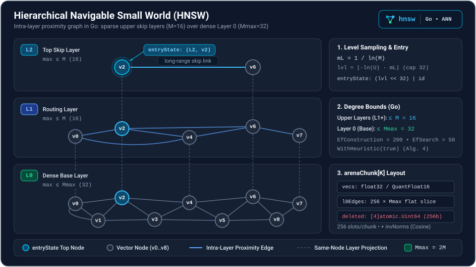
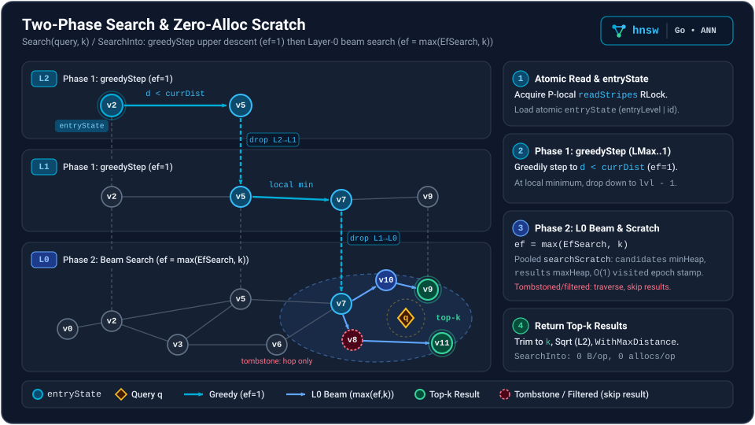
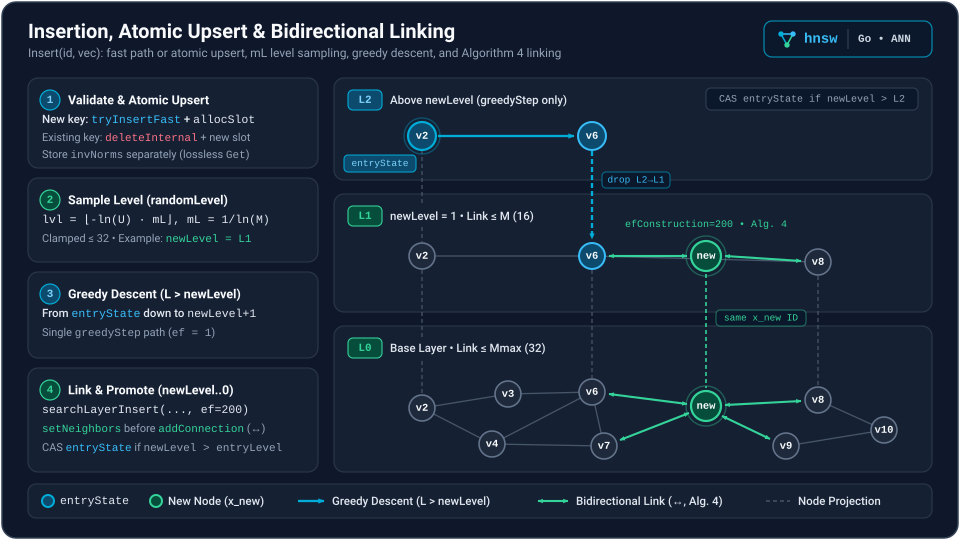
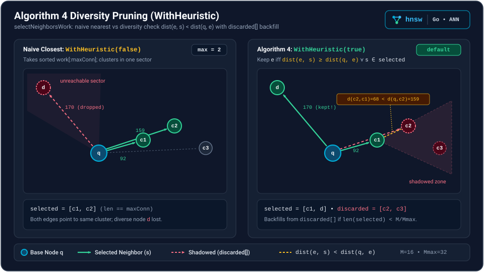
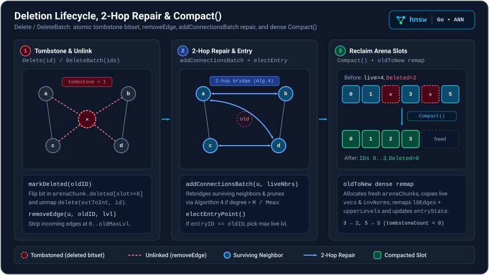
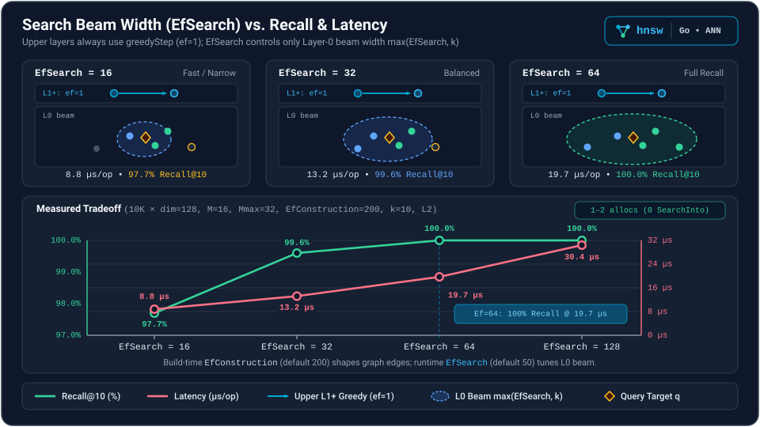

# hnsw

[](https://github.com/BryceWayne/hnsw/actions/workflows/go.yml)
[](https://pkg.go.dev/github.com/BryceWayne/hnsw)
[](https://github.com/BryceWayne/hnsw/releases)

[](./LICENSE)

**`hnsw`** is a concurrency-safe, zero-allocation-hot-path, **embeddable Go vector database library** implementing Hierarchical Navigable Small World (HNSW) approximate nearest neighbor (ANN) search.

Designed strictly as an embeddable Go package with minimal dependencies (`golang.org/x/sys` only for runtime CPUID feature detection), `hnsw` combines a flat contiguous `float32` memory arena, `amd64` AVX2+FMA Plan 9 assembly distance kernels, Algorithm 4 diversity-aware graph construction, and streaming CRC32-checksummed binary persistence.

---

## Key Capabilities

- **Generic Embeddable API (`Index[K comparable]`)**: Type-safe keys (`int`, `uint64`, `string`, `[16]byte`, or any `comparable` struct) with validated `Option` configuration and structured sentinel errors.
- **Flat Chunked Memory Arena**: Vectors and layer-0 adjacency lists live in 256-slot contiguous `arenaChunk` slabs indexed by dense `uint32` internal IDs, maximizing cache locality and minimizing GC pressure.
- **Zero-Allocation Hot-Path Search**: `sync.Pool`-backed `searchScratch` with epoch-stamped `[]uint32` visited tables and hole-sifting value-typed heaps reduces steady-state `Search` to **1 allocation/op** (result slice only) and `SearchInto` to **0 B/op, 0 allocs/op**.
- **Cross-Platform SIMD Acceleration & FP16 Quantization**: Multi-accumulator AVX2+FMA+F16C Plan 9 assembly (`amd64`) and 4-accumulator NEON Plan 9 assembly (`arm64` — Apple Silicon / AWS Graviton) accelerate distance kernels (~3–8x faster than scalar Go), while optional `WithQuantization(QuantFloat16)` halves vector RAM & file size and speeds up `dim=1536` search by **1.75x**. Other architectures and `-tags purego` builds use portable pure-Go fallbacks.
- **Concurrency-Safe CRUD & Bounded Batching**: Striped `[4096]sync.RWMutex` per-node locks, atomic entry-point state, atomic key upserts (`Insert`), tombstoned deletion + 2-hop repair (`Delete`, `DeleteBatch`), arena reclamation (`Compact`), and bounded worker pools (`InsertBatch`, `SearchBatch`).
- **HNSW Algorithm 4 & Flexible Search**: Diversity-aware neighbor selection (`WithHeuristic`), `mL = 1 / ln(M)` level sampling, lossless `Get` on `MetricCosine` (inverse norms stored separately), predicate filtering (`SearchFilter`), per-query `WithSearchEf`, and `context.Context` cancellation (`WithContext`).
- **Streaming Binary Persistence**: Versioned, CRC32-checksummed, tombstone-free binary format via `WriteTo(io.Writer)` / `ReadFrom(io.Reader)` and atomic `SaveFile` / `LoadFile`.

---

## Installation

Requires **Go 1.23+**:

```bash
go get github.com/BryceWayne/hnsw
```

---

## Quick Start

```go
package main

import (
	"fmt"
	"log"

	"github.com/BryceWayne/hnsw"
)

func main() {
	// Create a 4-dimensional cosine similarity index.
	idx, err := hnsw.New[string](
		4,
		hnsw.WithM(16),
		hnsw.WithMmax(32),
		hnsw.WithEfConstruction(200),
		hnsw.WithEfSearch(64),
		hnsw.WithMetric(hnsw.MetricCosine),
		hnsw.WithSeed(42),
	)
	if err != nil {
		log.Fatal(err)
	}

	// Insert vectors (calling Insert on an existing key atomically upserts it).
	docs := map[string][]float32{
		"go":     {1.0, 0.2, 0.0, 0.0},
		"rust":   {0.9, 0.4, 0.0, 0.0},
		"python": {0.1, 0.9, 0.2, 0.0},
		"sql":    {0.0, 0.1, 0.9, 0.3},
	}
	for id, vec := range docs {
		if err := idx.Insert(id, vec); err != nil {
			log.Fatal(err)
		}
	}

	// Query top-2 nearest neighbors.
	results, err := idx.Search([]float32{1.0, 0.25, 0.0, 0.0}, 2)
	if err != nil {
		log.Fatal(err)
	}
	for _, r := range results {
		fmt.Printf("id=%s distance=%.4f\n", r.ID, r.Distance)
	}
}
```

---

## Core Workflows

### Batch Insert, Search & Delete

`InsertBatch` and `SearchBatch` validate all inputs up front and execute across a bounded worker pool configured with `WithWorkers`.

```go
items := []hnsw.Item[int]{
	{ID: 1, Vector: []float32{0, 0, 1}},
	{ID: 2, Vector: []float32{0, 1, 0}},
	{ID: 3, Vector: []float32{1, 0, 0}},
}
if err := idx.InsertBatch(items, hnsw.WithWorkers(4), hnsw.WithContext(ctx)); err != nil {
	log.Fatal(err)
}

queries := [][]float32{{0, 0, 1}, {1, 0, 0}}
batchResults, err := idx.SearchBatch(queries, 2, hnsw.WithWorkers(4), hnsw.WithSearchEf(80))
if err != nil {
	log.Fatal(err)
}

removed := idx.DeleteBatch([]int{2})
_ = removed
_ = batchResults
```

### Filtered Search & Per-Query Options

`SearchFilter` evaluates a caller predicate during layer-0 graph traversal without post-filtering truncation, and `WithSearchEf` / `WithContext` tune recall/latency or attach cancellation per call.

```go
results, err := idx.SearchFilter(
	query,
	5,
	func(id int) bool { return id%2 == 0 },
	hnsw.WithSearchEf(100),
	hnsw.WithContext(ctx),
)
if err != nil {
	log.Fatal(err)
}
```

### Upsert, Deletion & Compaction

```go
// Atomic upsert replaces the vector for key 1 without stale neighbor links.
if err := idx.Insert(1, []float32{0.5, 0.5, 0}); err != nil {
	log.Fatal(err)
}

// Tombstone key 1 and repair 2-hop neighborhoods.
if deleted := idx.Delete(1); deleted {
	// Reclaim tombstoned arena slots and densely remap live nodes.
	if err := idx.Compact(); err != nil {
		log.Fatal(err)
	}
}

stats := idx.Stats()
fmt.Printf("live=%d deleted=%d capacity=%d mem=%dB\n",
	stats.Len, stats.Deleted, stats.Capacity, stats.MemoryBytes)
```

### Streaming & File Persistence

Indexes serialize to a compact, versioned, CRC32-verified, tombstone-free binary format. Custom distance indexes require passing `WithCustomDistance` when loading.

```go
// In-memory / streaming persistence
var buf bytes.Buffer
if _, err := idx.WriteTo(&buf); err != nil {
	log.Fatal(err)
}
reloaded, err := hnsw.ReadFrom[int](&buf)
if err != nil {
	log.Fatal(err)
}

// Atomic file persistence (temp file + rename)
if err := idx.SaveFile("index.bin"); err != nil {
	log.Fatal(err)
}
fromDisk, err := hnsw.LoadFile[int]("index.bin", hnsw.WithEfSearch(80))
if err != nil {
	log.Fatal(err)
}
_, _ = reloaded, fromDisk
```

### Distance Helpers & Custom Metrics

Standalone helpers validate dimension equality, non-empty length, and finite inputs (`ErrInvalidDimension`, `ErrDimensionMismatch`, `ErrNaNOrInf`):

```go
dL2, err := hnsw.Euclidean(a, b)
dL2Sq, err := hnsw.SquaredEuclidean(a, b)
dCos, err := hnsw.Cosine(a, b)       // 1 - cosine_similarity, clamped to [0, 2]; 1.0 if zero-norm
dot, err := hnsw.DotProduct(a, b)    // raw inner product (note: MetricDotProduct ranks by -dot)

// Custom distance metric (smaller values = closer vectors)
l1 := func(x, y []float32) float32 {
	var sum float32
	for i := range x {
		diff := x[i] - y[i]
		if diff < 0 {
			diff = -diff
		}
		sum += diff
	}
	return sum
}
customIdx, err := hnsw.New[string](128, hnsw.WithCustomDistance(l1))
```

---

## Running the Example Demo

A runnable demonstration program lives in [`examples/main.go`](./examples/main.go):

```bash
go run ./examples \
  -d 128 \
  -n 5000 \
  -m 16 \
  -mmax 32 \
  -ef 200 \
  -ef-search 64 \
  -k 10 \
  -euclidean=true \
  -workers 8 \
  -o /tmp/hnsw_demo.bin
```

| Flag | Default | Description |
|---|---|---|
| `-d` | `128` | Vector dimension |
| `-n` | `1000` | Number of vectors to insert |
| `-m` | `16` | Max connections per upper layer |
| `-mmax` | `32` | Max connections at layer 0 |
| `-ef` | `100` | `EfConstruction` candidate list size |
| `-ef-search` | `50` | `EfSearch` candidate list size |
| `-k` | `10` | Nearest neighbors to return |
| `-euclidean` | `true` | Use `MetricEuclidean` (`false` for `MetricCosine`) |
| `-o` | `hnsw_index.bin` | Output path for `SaveFile` / `LoadFile` verification |
| `-workers` | `runtime.GOMAXPROCS(0)` | Worker count for `InsertBatch` |

---

## API Reference & Defaults

### Construction Options (`Option`)

| Option | Default | Description |
|---|---|---|
| `WithM(m int)` | `16` | Target bidirectional links per node on upper layers (`[2, 65535]`) |
| `WithMmax(mmax int)` | `2 * M` (`32`) | Max bidirectional links per node on layer 0 (`[M, 65535]`) |
| `WithEfConstruction(ef int)` | `200` | Beam search width during index construction (`> 0`) |
| `WithEfSearch(ef int)` | `50` | Default beam search width during queries (`> 0`) |
| `WithMetric(m Metric)` | `MetricEuclidean` | Built-in distance metric (`MetricEuclidean`, `MetricSquaredEuclidean`, `MetricCosine`, `MetricDotProduct`) |
| `WithCustomDistance(fn DistanceFunc)` | `nil` | Custom dissimilarity function (smaller = closer) |
| `WithSeed(seed int64)` | time-seeded | PRNG seed for deterministic HNSW level assignment |
| `WithHeuristic(enabled bool)` | `true` | Enable Algorithm 4 diversity-aware neighbor pruning |
| `WithQuantization(q Quantization)` | `QuantNone` | Vector storage encoding (`QuantNone` float32 or `QuantFloat16` binary16 for 2x lower RAM & faster high-dim search) |

### Per-Call Search & Batch Options (`SearchOption`)

| Option | Description |
|---|---|
| `WithSearchEf(ef int)` | Override `EfSearch` for a single `Search`, `SearchInto`, `SearchFilter`, or `SearchBatch` call |
| `WithMaxDistance(maxDist float32)` | Filter returned results to neighbors with final `Distance <= maxDist` |
| `WithContext(ctx context.Context)` | Attach cancellation/deadline to search or batch operations |
| `WithWorkers(n int)` | Set bounded worker pool size for `InsertBatch` / `SearchBatch` (default `GOMAXPROCS`) |

### `Index[K comparable]` Methods & Top-Level Functions

- **Constructors / Loaders**: `New[K](dim int, opts ...Option) (*Index[K], error)`, `ReadFrom[K](r io.Reader, opts ...Option) (*Index[K], error)`, `LoadFile[K](path string, opts ...Option) (*Index[K], error)`
- **Write / Mutate**: `Insert(id K, vec []float32) error`, `InsertBatch(items []Item[K], opts ...SearchOption) error`, `Delete(id K) bool`, `DeleteBatch(ids []K) int`, `Compact() error`, `Clear()`, `SetEfSearch(ef int) error`
- **Query / Inspect**: `Search(query []float32, k int, opts ...SearchOption) ([]SearchResult[K], error)`, `SearchInto(query []float32, k int, dst []SearchResult[K], opts ...SearchOption) ([]SearchResult[K], error)`, `SearchFilter(query []float32, k int, filter func(id K) bool, opts ...SearchOption) ([]SearchResult[K], error)`, `SearchBatch(queries [][]float32, k int, opts ...SearchOption) ([][]SearchResult[K], error)`, `Get(id K) ([]float32, bool)`, `Contains(id K) bool`, `Keys() []K`, `All() iter.Seq2[K, []float32]`, `Len() int`, `Dim() int`, `Stats() IndexStats`
- **Persist**: `WriteTo(w io.Writer) (int64, error)`, `SaveFile(path string) error`

### `IndexStats` Fields

`Len`, `Deleted`, `Capacity`, `Dim`, `MaxLevel`, `EntryPointSet`, `M`, `Mmax`, `EfConstruction`, `EfSearch`, `Metric`, `Quantization`, `Heuristic`, `MemoryBytes`.

### Sentinel Errors

| Sentinel Error | Condition |
|---|---|
| `ErrInvalidDimension` | Dimension `<= 0` or empty vectors |
| `ErrDimensionMismatch` | Vector length does not match index/pair dimension |
| `ErrInvalidConfig` | Invalid option value or conflicting metric on load |
| `ErrInvalidK` | Requested `k <= 0` |
| `ErrNaNOrInf` | Vector contains `NaN` or `±Inf` |
| `ErrNotFound` | Referenced item does not exist |
| `ErrCorruptedIndex` | Invalid magic/version/bounds, key type mismatch, or CRC32 failure |

---

## Algorithm Overview



HNSW builds a hierarchical proximity graph where upper layers act as sparse long-range skip links and layer 0 maintains dense local connectivity (`Mmax` edges per node).

- **Search**: Starts at the atomic `entryState` top node, greedily descends from `MaxLevel` down to layer `1`, then runs a best-first beam search at layer `0` with beam width `max(efSearch, k)` using pooled `searchScratch` buffers and an atomic tombstone bitset.



- **Insertion & Upsert**: Validates and copies the input vector (storing inverse norms separately for `MetricCosine` so `Get` remains lossless), atomically replaces any existing key, samples a level using `mL = 1 / ln(M)`, descends greedily to `newLevel + 1`, and connects bidirectionally at each layer using Algorithm 4 diversity-aware neighbor selection (`WithHeuristic`).




- **Deletion & Compaction**: `Delete` and `DeleteBatch` flip bits in the per-chunk atomic tombstone bitset, unlink incoming edges, perform 2-hop neighborhood repair among surviving neighbors, and re-elect the entry point if needed. `Compact()` reclaims tombstoned arena slots and densely remaps live nodes.




---

## Measured Recall & Benchmarks

All measurements below were collected directly from this codebase (`go1.23.3 linux/amd64` on **12th Gen Intel(R) Core(TM) i9-12900K**, 12 CPUs) using `go test -run=^$ -bench=. -benchmem -benchtime=100ms -count=5 .` (medians reported) and `go test -run=TestRecall10K -v .`.

### Recall@K & Query Latency (`BenchmarkRecallAndLatency`, 10K Clustered Vectors, `dim=128`, `M=16`, `Mmax=32`, `EfConstruction=200`, `k=10`)

| Metric | `EfSearch` | Latency (`ns/op`) | Throughput (`queries/s`) | `Recall@1` | `Recall@10` | `B/op` | `allocs/op` |
|---|---|---|---|---|---|---|---|
| `MetricEuclidean` | `16` | `8,765` | `114,090` | `0.9900` | `0.9770` | `208` | `2` |
| `MetricEuclidean` | `32` | `13,235` | `75,559` | `0.9900` | `0.9960` | `208` | `2` |
| `MetricEuclidean` | `64` | `19,657` | `50,872` | `1.0000` | `1.0000` | `208` | `2` |
| `MetricEuclidean` | `128` | `30,376` | `32,920` | `1.0000` | `1.0000` | `208` | `2` |
| `MetricCosine` | `16` | `10,365` | `96,480` | `0.9900` | `0.9850` | `208` | `2` |
| `MetricCosine` | `32` | `15,020` | `66,578` | `1.0000` | `0.9980` | `208` | `2` |
| `MetricCosine` | `64` | `21,245` | `47,069` | `1.0000` | `1.0000` | `208` | `2` |
| `MetricCosine` | `128` | `31,930` | `31,319` | `1.0000` | `1.0000` | `208` | `2` |

*(Note: `Search(query, 10)` with default options uses **160 B/op, 1 allocs/op** — solely the returned result slice; passing `WithSearchEf(ef)` adds 1 option closure allocation.)*

- **`TestRecall10K`** (`10K` clustered vectors, `dim=32`, `M=16`, `EfConstruction=200`, `EfSearch=100`): **`Recall@1=1.0000`, `Recall@10=1.0000`**.

### Filtered Search & Binary Persistence (`10K x dim=128`)

| Benchmark | Latency (`ns/op`) | Throughput | `Recall@10` | `B/op` | `allocs/op` |
|---|---|---|---|---|---|
| `BenchmarkSearchFilter/selectivity=50pct` (`ef=64`) | `77,246` | `12,946 queries/s` | `0.9920` | `208` | `2` |
| `BenchmarkSearchFilter/selectivity=10pct` (`ef=64`) | `173,822` | `5,753 queries/s` | `0.9990` | `208` | `2` |
| `BenchmarkPersistence/WriteTo_10K_dim128` | `4,597,643` | `1,430.34 MB/s` | — | `152,568` | `17` |
| `BenchmarkPersistence/ReadFrom_10K_dim128` | `4,052,509` | `1,622.74 MB/s` | — | `7,708,338` | `1,511` |

### FP16 Quantization (`QuantFloat16` + AVX2+F16C+FMA) vs `float32` (`5K` Vectors, `SearchInto`, `0 allocs/op`)

| Operation & Dim | `QuantNone` (`float32`) | `QuantFloat16` (`binary16`) | Speedup / Savings |
|---|---|---|---|
| `Search` (12T, `dim=768`) | `9,465 ns/op` (`105,654 q/s`) | **`6,739 ns/op`** (`148,385 q/s`) | **`1.40x` faster** |
| `Arena RAM` (`dim=768`) | `15.93 MB` | **`8.43 MB`** | **`-47.1%` RAM** |
| `ReadFrom` (`dim=768`) | `8.70 ms` (`15.34 MB` file) | **`4.51 ms`** (`8.02 MB` file) | **`1.93x` faster, `-47.7%` size** |
| `Search` (12T, `dim=1536`) | `21,358 ns/op` (`46,822 q/s`) | **`12,228 ns/op`** (`81,776 q/s`) | **`1.75x` faster** |
| `Arena RAM` (`dim=1536`) | `30.93 MB` | **`15.93 MB`** | **`-48.5%` RAM** |
| `ReadFrom` (`dim=1536`) | `17.17 ms` (`29.99 MB` file) | **`8.67 ms`** (`15.34 MB` file) | **`1.98x` faster, `-48.9%` size** |

### Distance Kernel Microbenchmarks (`BenchmarkDistanceAVX2VsFallback`, `0 B/op`, `0 allocs/op`)

| Kernel & Dim | AVX2+FMA (`ns/op`) | Pure Go (`ns/op`) | Speedup |
|---|---|---|---|
| `L2Sq dim=32` | `2.445` | `6.945` | `2.84x` |
| `L2Sq dim=128` | `3.773` | `27.41` | `7.26x` |
| `L2Sq dim=384` | `9.385` | `82.23` | `8.76x` |
| `L2Sq dim=768` | `20.56` | `162.7` | `7.91x` |
| `L2Sq dim=1536` | `39.54` | `321.8` | `8.14x` |
| `Dot dim=32` | `2.202` | `5.825` | `2.65x` |
| `Dot dim=128` | `3.541` | `18.67` | `5.27x` |
| `Dot dim=384` | `8.501` | `59.08` | `6.95x` |
| `Dot dim=768` | `16.73` | `113.9` | `6.81x` |
| `Dot dim=1536` | `34.05` | `218.9` | `6.43x` |

### End-to-End Search: AVX2+FMA vs Pure Go (`-tags purego`) (`160 B/op`, `1 allocs/op`)

| Benchmark | AVX2+FMA (`ns/op`) | AVX2 (`queries/s`) | Pure Go (`ns/op`) | Pure Go (`queries/s`) | Speedup |
|---|---|---|---|---|---|
| `BenchmarkSearch` (1T, `1K x 128`) | `10,435` | `95,834` | `30,027` | `33,304` | `2.88x` |
| `BenchmarkSearchComparison/Size_1000_Dim_32` (12T) | `962.5` | `1,038,936` | `1,367` | `731,663` | `1.42x` |
| `BenchmarkSearchComparison/Size_1000_Dim_128` (12T) | `1,422` | `703,027` | `3,367` | `297,022` | `2.37x` |
| `BenchmarkSearchComparison/Size_1000_Dim_512` (12T) | `3,392` | `294,820` | `11,935` | `83,785` | `3.52x` |
| `BenchmarkSearchComparison/Size_10000_Dim_32` (12T) | `1,536` | `651,199` | `2,742` | `364,681` | `1.79x` |
| `BenchmarkSearchComparison/Size_10000_Dim_128` (12T) | `2,878` | `347,470` | `7,784` | `128,477` | `2.70x` |
| `BenchmarkSearchComparison/Size_10000_Dim_512` (12T) | `10,060` | `99,402` | `22,233` | `44,978` | `2.21x` |

### Parallel `SearchBatch` Scaling (`BenchmarkParallelSearchScaling`, `10K x dim=256`, 64 queries/batch)

| Threads | Batch Latency (`ns/op`) | Throughput (`queries/s`) | Speedup vs 1T |
|---|---|---|---|
| `1` | `3,728,925` | `17,163` | `1.00x` |
| `2` | `1,819,927` | `35,166` | `2.05x` |
| `4` | `992,615` | `64,476` | `3.76x` |
| `8` | `744,247` | `85,993` | `5.01x` |
| `16` (12 CPUs) | `622,595` | `102,795` | `5.99x` |

- **Insertion & Deletion Throughput**: `BenchmarkInsert` (single-goroutine `Insert`): **`10,129 vecs/s`** (`98,724 ns/vec`, `122 allocs/op`); `BenchmarkBatchOperations/InsertBatch` (12-CPU worker pool): **`46,964 vecs/s`** (`21,293 ns/vec`, `526 allocs/op`); `BenchmarkDelete`: **`188,632 ns/op`** (`0 B/op`, `0 allocs/op`).

---

## Parameter Tuning Guide

- **`M` & `Mmax`**: Higher `M` (`16–32`, with `Mmax = 2*M`) improves recall on high-dimensional or tightly clustered datasets at the cost of memory and build time. Lower `M` (`8–12`) shrinks memory footprint.
- **`EfConstruction`**: Controls graph quality during build (`100–400`). Higher values increase build time linearly while permanently improving search recall/latency trade-offs.
- **`EfSearch` / `WithSearchEf`**: Controls query-time recall vs latency (`16–256`) without rebuilding the index. Always clamped to `>= k`.
- **`WithHeuristic(true)`**: Recommended default; prevents hub clustering and maintains long-range reachability (Algorithm 4).

---

## Project Structure

```text
hnsw/
├── .github/
│   ├── CODEOWNERS             # Maintainer approval rules for protected root branch
│   ├── ISSUE_TEMPLATE/        # Bug report and feature request templates
│   ├── pull_request_template.md
│   └── workflows/go.yml       # CI: gofmt, vet, -race (x86_64 + ARM64), purego, fuzz, cross-builds, lint, govulncheck
├── docs/images/               # HNSW visual diagrams
├── examples/main.go           # Standalone CLI demo
├── internal/simd/             # amd64 AVX2+FMA+F16C, arm64 NEON, and pure-Go distance/FP16 kernels
├── batch.go                   # InsertBatch, SearchBatch, DeleteBatch
├── distance.go                # Public Metric, DistanceFunc, and standalone distance helpers
├── doc.go                     # Package-level GoDoc overview
├── errors.go                  # Structured sentinel errors
├── heap.go                    # Hole-sifting value-typed min/max binary heaps
├── hnsw.go                    # Index[K], flat chunked arena, Algorithm 4, Delete, Compact, Keys, All
├── options.go                 # Functional Option and SearchOption types
├── quantization.go            # Quantization (QuantNone, QuantFloat16) and FP16 metric helpers
├── scratch.go                 # Pooled epoch-stamped searchScratch
├── search.go                  # Search, SearchInto, SearchFilter, WithMaxDistance
├── serialize.go               # Versioned (v1/v2) CRC32 binary WriteTo/ReadFrom/SaveFile/LoadFile
├── *_test.go                  # Unit, fuzz (FuzzReadFrom), concurrency (-race), recall, examples, and benchmarks
├── CHANGELOG.md               # Release history
├── CONTRIBUTING.md            # Contribution and verification guide
├── SECURITY.md                # Security policy and bounded-deserialization notes
├── .editorconfig              # Editor formatting rules
├── .golangci.yml              # golangci-lint v2 configuration
├── go.mod / go.sum            # Minimal module definition (golang.org/x/sys only)
├── LICENSE                    # MIT License
└── README.md
```

---

## Verification Commands

```bash
gofmt -l .
go vet ./...
go doc -all .
go test -v -race ./...
go test -tags purego -v -race ./...
go test -run=TestSearchZeroAllocs -v .
GOOS=linux GOARCH=arm64 go vet ./... && GOOS=linux GOARCH=arm64 go build ./...
GOOS=darwin GOARCH=arm64 go vet ./... && GOOS=darwin GOARCH=arm64 go build ./...
GOOS=windows GOARCH=amd64 go vet ./... && GOOS=windows GOARCH=amd64 go build ./...
go test -run=^$ -bench=. -benchmem -benchtime=50ms ./...
```

---

## License

[MIT License](./LICENSE) — Copyright (c) 2024 Bryce Wayne
